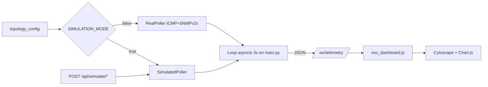

# ARCHITECTURE — NOC Topology & Real-Time Telemetry Dashboard

Dashboard de portafolio estilo Centro de Comando NOC que muestra la topología de red y telemetría en tiempo real (latencia, pérdida de paquetes, estado de interfaces, ancho de banda y CPU).

## 1. Stack Tecnológico

### Backend
- **Python 3.12**
- **FastAPI** + **Uvicorn** (ASGI).
- **WebSockets nativos** de FastAPI/Starlette (`/ws/telemetry`).
- **`asyncio`** para sondeo concurrente en segundo plano (`asyncio.gather` con timeout estricto de 1.5 s por sondeo).

### Protocolos de Telemetría
| Protocolo | Librería | Métricas |
|---|---|---|
| ICMP asíncrono | `icmplib` (`async_ping`) | Latencia (ms), pérdida de paquetes (%) |
| SNMPv2c | `pysnmp-lextudio` (API asyncio) | `ifOperStatus` (1.3.6.1.2.1.2.2.1.8), `ifInOctets` (1.3.6.1.2.1.2.2.1.10), `ifOutOctets` (1.3.6.1.2.1.2.2.1.16), CPU Cisco IOS `cpmCPUTotal5secRev` (1.3.6.1.4.1.9.9.109.1.1.1.1.6.1) |

### Modo Simulador (`SIMULATION_MODE=true` en `.env`)
- Motor de telemetría simulada que genera datos realistas (latencia con jitter, tráfico con tendencia sinusoidal + ruido, CPU variable, contadores de octetos monotónicos con wrap a 32 bits).
- Permite disparar fallos manuales desde la API para desarrollar y probar el frontend sin GNS3:
  - `POST /api/simulate/toggle-link/{edge_id}`
  - `POST /api/simulate/toggle-node/{node_id}`
- Con `SIMULATION_MODE=false` se usa el poller real (ICMP + SNMPv2c). Ambos pollers comparten la misma interfaz (`BasePoller`) y producen el mismo payload.

### Frontend (Zero-Build)
- HTML5 semántico, **Tailwind CSS (CDN)**.
- **Cytoscape.js (CDN)**: grafo interactivo de topología.
- **Chart.js (CDN)**: gráficas en tiempo real de ancho de banda (Kbps) y CPU (%).
- Sin bundlers ni `npm`; se sirve directamente desde FastAPI (`StaticFiles` + `Jinja2Templates`).

## 2. Estructura del Repositorio

```
NOC-Telemetry-Dashboard/
├── main.py                  # App FastAPI, REST, WebSocket manager, tarea de fondo (3 s)
├── telemetry_engine.py      # Poller real (ICMP+SNMP) y Poller simulado, cálculo de Kbps
├── topology_config.py       # Nodos y enlaces (Python/JSON)
├── templates/
│   └── dashboard.html       # UI NOC modo oscuro
├── static/
│   └── js/
│       └── noc_dashboard.js # Cliente WS, Cytoscape, Chart.js
├── test_telemetry.py        # Pruebas unitarias y de integración
├── requirements.txt         # Dependencias con versiones fijadas
├── pytest.ini               # Configuración de pytest
├── .env.example
├── .gitignore
├── ARCHITECTURE.md
└── RULES.md
```

### Responsabilidades por archivo
- **`main.py`**
  - Instancia FastAPI, monta `/static` y renderiza `templates/dashboard.html`.
  - Endpoints REST: `GET /api/topology`, `GET /api/config`, `GET /api/telemetry/latest`, `GET /api/events`, `POST /api/simulate/toggle-link/{edge_id}`, `POST /api/simulate/toggle-node/{node_id}` (solo activos en modo simulación; 409 en caso contrario).
  - `ConnectionManager` para `/ws/telemetry` (connect, disconnect, broadcast tolerante a fallos).
  - Tarea `asyncio` en `lifespan` que cada **3 segundos** sondea, calcula y difunde el payload.
- **`telemetry_engine.py`**
  - `RealPoller`: ICMP + SNMPv2c concurrentes con `asyncio.gather` y `asyncio.wait_for(..., 1.5)`.
  - `SimulatedPoller`: generador realista con fallos manuales y propagación nodo → enlaces.
  - `calculate_kbps(prev_octets, curr_octets, delta_seconds, counter_bits=32)`: delta de octetos/s → Kbps, con manejo de wrap del contador de 32 bits ($2^{32}$) y `delta <= 0`.
  - Derivación de estado: `up`, `degraded`, `down`.
- **`topology_config.py`**
  - Dataclasses para `Node` (id, tipo: `router|switch|server`, IP, nombre, rol, posición) y `Edge` (id, origen/destino, interfaces e `ifIndex`). Cargable desde Python o JSON.
- **`templates/dashboard.html`**: cabecera con KPIs globales, lienzo Cytoscape, panel lateral dinámico, controles de simulación, log de eventos e indicador de conexión WS.
- **`static/js/noc_dashboard.js`**
  - Cliente WebSocket con reconexión automática (backoff exponencial con tope).
  - Colores: **verde = `up` (`#10b981`)**, **rojo = `down` (`#ef4444`)**, **ámbar = `degraded` (`#f59e0b`)**.
  - Al hacer clic en un nodo se abre el panel lateral con gráficas Chart.js (Kbps y CPU) con ventana deslizante.
- **`test_telemetry.py`**: pruebas (`pytest`) de cálculo de ancho de banda (incl. wrap), umbrales de estado, cambios de estado de topología tras toggles, contratos REST/WebSocket y serialización JSON del payload.

## 3. Reglas de Estado Operativo (`status`)

### Nodos
| Estado | Condición |
|---|---|
| `down` | Pérdida ICMP `== 100 %` (timeout de 1.5 s) **o** todas las interfaces monitoreadas del nodo con `ifOperStatus != 1` |
| `degraded` | Responde ICMP pero latencia `>= 50 ms`, pérdida de paquetes entre `1 %` y `99 %`, uso de CPU `>= 80 %`, fallo parcial de consulta SNMP (sin métricas SNMP) **o** alguna (no todas) interfaz monitoreada con `ifOperStatus != 1` |
| `up` | Pérdida `0 %`, latencia `< 50 ms`, CPU `< 80 %`, SNMP operativo completo e interfaces monitoreadas con `ifOperStatus == 1` |

### Enlaces
| Estado | Condición |
|---|---|
| `down` | `ifOperStatus != 1` en cualquiera de sus interfaces **o** algún nodo extremo en estado `down` |
| `degraded` | `ifOperStatus == 1` (o consulta SNMP parcial) sin métricas SNMP completas de la interfaz y extremos no `down` |
| `up` | `ifOperStatus == 1` con métricas válidas y nodos extremos no `down` |

## 4. Flujo de Datos



## 5. Contrato del Payload WebSocket (JSON)

Definido formalmente en `specs/001-noc-telemetry-dashboard/contracts/telemetry-message.schema.json`:

```json
{
  "type": "telemetry",
  "timestamp": "2026-11-18T18:51:30Z",
  "simulation": true,
  "nodes": [
    {
      "id": "R1-Core",
      "status": "up",
      "latency_ms": 2.4,
      "packet_loss": 0.0,
      "cpu_percent": 17.0,
      "bw_in_kbps": 1530.2,
      "bw_out_kbps": 980.7
    }
  ],
  "edges": [
    {
      "id": "link-r1-r2",
      "status": "up",
      "oper_status": 1,
      "bw_in_kbps": 1200.4,
      "bw_out_kbps": 830.2
    }
  ],
  "events": [
    {
      "id": 1,
      "timestamp": "2026-11-18T18:51:30Z",
      "element_type": "edge",
      "element_id": "link-r1-r2",
      "kind": "down",
      "previous": "up",
      "current": "down",
      "message": "Enlace link-r1-r2 cayó (down)"
    }
  ]
}
```

## 6. Configuración (`.env`)
Ver `.env.example`: `SIMULATION_MODE`, `POLL_INTERVAL_SECONDS`, `POLL_TIMEOUT_SECONDS`, `SNMP_COMMUNITY`, `SNMP_PORT`, `LATENCY_DEGRADED_MS`, `CPU_DEGRADED_PERCENT`, `LINK_MAX_KBPS`, `ICMP_PRIVILEGED`, `SIMULATION_SEED`, `HOST`, `PORT`.
