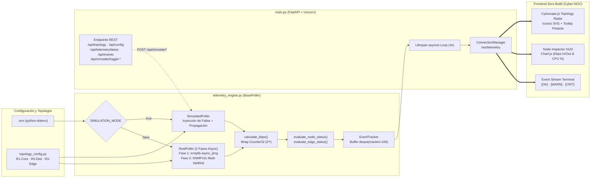

# NOC Topology & Real-Time Telemetry Dashboard


Plataforma de observabilidad de red y centro de comando táctico (**Cyber-NOC Tactical Command Center**) diseñada bajo prácticas **NetDevOps**. Combina un motor de sondeo **100 % asíncrono** en Python (`asyncio`, `icmplib` y `pysnmp-lextudio`) con difusión en tiempo real mediante **WebSockets nativos de FastAPI** y una interfaz *zero-build* equipada con radar interactivo de topología (**Cytoscape.js**) y series temporales deslizantes (**Chart.js**).

---

## 1. Resumen Ejecutivo

En un Centro de Operaciones de Red (NOC), la visibilidad de la topología y la detección inmediata de caídas de enlaces o degradación de rendimiento son críticas. **NOC Topology & Real-Time Telemetry Dashboard** resuelve este problema ofreciendo:

- **Descubrimiento y monitoreo continuo de estado operativo (`up`, `degraded`, `down`)** combinando alcanzabilidad y RTT por **Ping ICMP asíncrono** con telemetría **SNMPv2c Multi-VarBind** (`ifOperStatus`, `ifInOctets`, `ifOutOctets`, `cpmCPUTotal5secRev`).
- **Arquitectura de Motor Dual (`BasePoller`)**:
  - **Modo Simulador (`SIMULATION_MODE=true`)**: permite ejecutar, demostrar y probar el dashboard e inyectar fallas en vivo sobre nodos y enlaces sin depender de un hipervisor ni laboratorio encendido.
  - **Modo Laboratorio Real (`SIMULATION_MODE=false`)**: sondea routers reales **Cisco IOSv** en GNS3 + VMware Workstation con tolerancia a *jitter* de virtualización QEMU y detección instantánea (`0` ciclos de gracia) ante caídas físicas o administrativas (`shutdown`).
- **Interfaz Táctica "Cyber-NOC"**: estética abisal (`#05080f`) con paneles *Glassmorphism*, iconos vectoriales SVG diferenciados por rol jerárquico (`Core`, `Distribution`, `Edge`), tooltip flotante de tráfico por enlace, inspector HUD con barras segmentadas y bitácora de eventos en vivo.

---

## 2. Características Principales y Arquitectura



### Motor de Telemetría (`telemetry_engine.py`)
- **Sondeo Concurrente en 2 Fases (`RealPoller`)**:
  1. **Fase 1 (ICMP Asíncrono)**: ejecuta `icmplib.async_ping` concurrentemente hacia todos los nodos (`asyncio.gather` con `timeout=1.5s`). Completar los ecos ICMP antes de disparar SNMP evita que el agente SNMP de `R1-Core` eleve el RTT de los paquetes ICMP en tránsito hacia `R2-Dist` y `R3-Edge`.
  2. **Fase 2 (SNMPv2c Multi-VarBind)**: agrupa en una única petición UDP `getCmd` todos los OIDs requeridos por router (`cpmCPUTotal5secRev` + `ifOperStatus`, `ifInOctets`, `ifOutOctets` de cada interfaz monitoreada), regulada por `asyncio.Semaphore(4)`, `timeout=3.0s` y `retries=1`. Si un nodo no responde ICMP (`100%` pérdida), se omite la consulta SNMP para no desperdiciar el ciclo.
- **Cálculo Exacto de Ancho de Banda (`calculate_kbps`)**:
  - Calcula tasas de transferencia ($\text{Kbps} = \frac{\Delta \text{octetos} \times 8}{\Delta t \times 1000}$) a partir de contadores monotónicos `Counter32`.
  - Maneja automáticamente el desbordamiento (*wrap*) de 32 bits ($2^{32} = 4\,294\,967\,296$), primera muestra sin referencia previa, deltas de tiempo no positivos y descarte de picos espurios por encima de `LINK_MAX_KBPS`.
- **Reglas de Estado Operativo y Tolerancia a Jitter**:

| Elemento | Estado `up` (`#00f59b`) | Estado `degraded` (`#ffb703`) | Estado `down` (`#ff2a5f`) |
|---|---|---|---|
| **Nodo** | Pérdida ICMP `0 %`, latencia `< 150 ms`, CPU `< 85 %`, SNMP completo e interfaces en `ifOperStatus == 1` | Latencia `>= 150 ms`, pérdida `1 %–99 %`, CPU `>= 85 %`, alguna interfaz caída (en nodo multi-interfaz) o fallo SNMP tras agotar **4 ciclos consecutivos de gracia** | **Inmediato (`0` ciclos de gracia):** pérdida ICMP `== 100 %` o todas las interfaces monitoreadas con `ifOperStatus != 1` |
| **Enlace** | `ifOperStatus == 1` con métricas SNMP válidas y nodos extremos no `down` | `ifOperStatus == 1` (o consulta SNMP parcial) sin métricas completas y nodos extremos no `down` | **Inmediato (`0` ciclos de gracia):** `ifOperStatus != 1` (ej. `2` por `shutdown`) o cualquier nodo extremo en `down` |

### Interfaz Visual "Cyber-NOC Tactical Command Center"
- **Paleta y Tipografía**: fondo abisal `#05080f` con cuadrícula técnica (*blueprint grid*) y barrido de radar animado; tipografías `Space Grotesk` (encabezados) y `JetBrains Mono` (telemetría, IPs, consolas); acentos en **Cian Eléctrico (`#06b6d4`)** y **Violeta Neón (`#8b5cf6`)**.
- **Grafo Cytoscape.js con Iconos SVG Dinámicos por Rol**:
  - `core` (`R1-Core`): hexágono redondeado con silueta SVG de **Core Router** (chasis cilíndrico, 4 flechas cruzadas y doble halo).
  - `distribution` (`R2-Dist`): rectángulo táctico con silueta de **Distribution Node** (chasis multicapa bidireccional).
  - `edge` (`R3-Edge`): rectángulo táctico con silueta de **Edge Gateway** (nodo perimetral con antena y enlace externo).
  - **Tooltip Flotante de Enlaces (`#edge-tooltip`)**: enlaces limpios sin texto superpuesto; al pasar el cursor sobre cualquier cable, se despliega un tooltip flotante junto al puntero con interfaces (`Gi0/1 ⇄ Gi0/1`), estado y tráfico (`IN / OUT Kbps`).
  - **Controles de Layout en Vivo**: alternancia instantánea entre vista **Jerárquica**, **Radial** y **Centrar Mapa**.
- **Node Inspector HUD (`#node-panel`)**: ficha técnica del router seleccionado, medidores segmentados de 20 bloques para **Latencia ICMP** y **Packet Loss**, y dos gráficas **Chart.js** con ventana deslizante de **40 muestras** y áreas degradadas translúcidas (Ancho de Banda `IN` Cian / `OUT` Magenta y Mapa Térmico de CPU con umbral al `85 %`).
- **Dock de Inyección de Fallas (`#sim-controls`) y Terminal de Eventos (`#events-log`)**: interruptores tácticos para tumbar/restaurar nodos o enlaces en modo simulador y consola con marcas `[HH:MM:SS]`, etiquetas `[OK]`, `[WARN]`, `[CRIT]` y auto-scroll.

---

## 3. Stack Tecnológico y Entorno Validado

### Dependencias Python (`requirements.txt`)
| Paquete | Versión Fijada | Rol en el Sistema |
|---|---|---|
| `fastapi` | `0.164.0` | Framework web ASGI, endpoints REST y servidor WebSocket `/ws/telemetry` |
| `uvicorn[standard]` | `0.54.0` | Servidor ASGI de alto rendimiento |
| `websockets` | `17.4` | Motor de transporte WebSocket |
| `icmplib` | `3.0.4` | Sondeo Ping ICMP 100 % asíncrono (`async_ping`) |
| `pysnmp-lextudio` | `6.3.0` | Cliente SNMPv2c asíncrono (`pysnmp.hlapi.asyncio.getCmd`) |
| `python-dotenv` | `1.2.4` | Carga segura de variables de entorno y comunidades SNMP desde `.env` |
| `jinja2` | `3.1.6` | Renderizado de la plantilla HTML principal (`templates/dashboard.html`) |
| `pytest` | `9.2.0` | Ejecutor de pruebas unitarias, de contrato e integración |
| `pytest-asyncio` | `1.5.0` | Soporte de corrutinas y bucles de eventos en pruebas |
| `httpx` | `0.28.1` | Cliente HTTP asíncrono (`ASGITransport`) para pruebas de endpoints REST |
| `jsonschema` | `4.26.0` | Validación formal del payload WebSocket contra JSON Schema Draft 2020-12 |

### Topología Validada en Laboratorio Real (GNS3 + VMware Workstation)
Validado en vivo contra 3 routers **Cisco IOSv 15.9(3)M6** con enrutamiento **OSPF** y SNMPv2c habilitado:

| ID de Nodo | Rol Jerárquico | Dirección IP | Interfaces Monitoreadas (`ifIndex` real) |
|---|---|---|---|
| **`R1-Core`** | `core` | `192.168.76.10` | `GigabitEthernet0/1` (`ifIndex = 2`) $\rightarrow$ `R2-Dist`<br/>`GigabitEthernet0/2` (`ifIndex = 3`) $\rightarrow$ `R3-Edge` |
| **`R2-Dist`** | `distribution` | `10.0.12.2` | `GigabitEthernet0/1` (`ifIndex = 2`) $\rightarrow$ `R1-Core` (`link-r1-r2`) |
| **`R3-Edge`** | `edge` | `10.0.13.2` | `GigabitEthernet0/1` (`ifIndex = 2`) $\rightarrow$ `R1-Core` (`link-r1-r3`) |

**OIDs SNMPv2c consultados:**
- `1.3.6.1.2.1.2.2.1.8.<ifIndex>` (`ifOperStatus`: `1 = up`, `2 = down`)
- `1.3.6.1.2.1.2.2.1.10.<ifIndex>` (`ifInOctets`)
- `1.3.6.1.2.1.2.2.1.16.<ifIndex>` (`ifOutOctets`)
- `1.3.6.1.4.1.9.9.109.1.1.1.1.6.1` (`cpmCPUTotal5secRev`)

---

## 4. Estructura del Repositorio

```text
NOC-Telemetry-Dashboard/
├── main.py                      # Aplicación FastAPI, endpoints REST, ConnectionManager WS y bucle lifespan
├── telemetry_engine.py          # Settings, calculate_kbps, RealPoller, SimulatedPoller y EventTracker
├── topology_config.py           # Modelos Node/Edge/Interface, topología gestionada y validador JSON
├── test_telemetry.py            # Suite de 37 pruebas automatizadas (unitarias, contrato, REST y WebSocket)
├── templates/
│   └── dashboard.html           # Interfaz HTML5 semántica "Cyber-NOC Tactical Command Center"
├── static/
│   ├── css/
│   │   └── noc_theme.css        # Tema visual abisal, blueprint grid, animaciones de radar e interruptores
│   └── js/
│       └── noc_dashboard.js     # Cliente WebSocket, grafo Cytoscape.js con SVGs, tooltip y Chart.js
├── specs/
│   └── 001-noc-telemetry-dashboard/
│       ├── spec.md              # Especificación funcional completa
│       ├── plan.md              # Plan de implementación técnica
│       ├── research.md          # Decisiones de arquitectura y protocolos
│       ├── data-model.md        # Entidades, restricciones y máquina de estados
│       ├── quickstart.md        # Escenarios de validación de extremo a extremo
│       ├── tasks.md             # Desglose de tareas (T001–T038 completadas)
│       ├── checklists/
│       │   └── requirements.md  # Checklist de calidad de especificación
│       └── contracts/
│           ├── rest-api.yaml                    # Contrato OpenAPI 3.1.0
│           ├── websocket-telemetry.md           # Especificación del canal /ws/telemetry
│           └── telemetry-message.schema.json    # Esquema JSON formal del snapshot
├── ARCHITECTURE.md              # Documento de arquitectura y flujo de datos
├── RULES.md                     # Reglas de gobernanza (asincronía, seguridad y calidad de código)
├── requirements.txt             # Dependencias Python con versiones exactas fijadas
├── pytest.ini                   # Configuración de pytest y asyncio_mode = auto
├── .env.example                 # Plantilla de variables de entorno (sin secretos reales)
└── .gitignore                   # Exclusión de .env, venv/, __pycache__/ y cachés
```

---

## 5. Guía de Instalación y Ejecución Local

### 5.1. Clonar el repositorio y crear el entorno virtual

**En Windows (PowerShell):**
```powershell
git clone https://github.com/mgc-cloud17/NOC-Telemetry-Dashboard.git
cd NOC-Telemetry-Dashboard
python -m venv venv
.\venv\Scripts\Activate.ps1
.\venv\Scripts\pip.exe install -r requirements.txt
```

**En Linux / macOS:**
```bash
git clone https://github.com/mgc-cloud17/NOC-Telemetry-Dashboard.git
cd NOC-Telemetry-Dashboard
python3 -m venv venv
source venv/bin/activate
pip install -r requirements.txt
```

### 5.2. Configurar variables de entorno (`.env`)

Copia la plantilla `.env.example` a `.env`:

```powershell
# Windows PowerShell
Copy-Item .env.example .env
```
```bash
# Linux / macOS
cp .env.example .env
```

Variables disponibles en `.env`:

```dotenv
# true = telemetría simulada (sin GNS3); false = sondeo real ICMP + SNMPv2c
SIMULATION_MODE=true

# Servidor ASGI
HOST=0.0.0.0
PORT=8000

# Temporización de sondeo (segundos)
POLL_INTERVAL_SECONDS=4
POLL_TIMEOUT_SECONDS=1.5
SNMP_TIMEOUT_SECONDS=3.0
SNMP_RETRIES=1

# SNMPv2c (comunidad configurada en los routers Cisco IOSv)
SNMP_COMMUNITY=NOC_RO
SNMP_PORT=161

# Umbrales operativos
LATENCY_DEGRADED_MS=150
CPU_DEGRADED_PERCENT=85
LINK_MAX_KBPS=1000000

# Opciones avanzadas
ICMP_PRIVILEGED=false
SIMULATION_SEED=
```

> **Nota sobre modos de ejecución y permisos ICMP:**
> - **Modo Simulador (`SIMULATION_MODE=true`)**: funciona de inmediato sin permisos especiales ni laboratorio externo; habilita el panel **Fault Injection** en la interfaz.
> - **Modo Laboratorio Real (`SIMULATION_MODE=false`)**: requiere conectividad IP hacia `192.168.76.10`, `10.0.12.2` y `10.0.13.2` y la comunidad SNMP configurada en `SNMP_COMMUNITY`. En Windows, si `icmplib` requiere sockets raw privilegiados, ejecuta la terminal como **Administrador** y ajusta `ICMP_PRIVILEGED=true`.

### 5.3. Ejecutar la suite de pruebas automatizadas

```powershell
.\venv\Scripts\pytest.exe -v
```

Resultado esperado: **`37 passed`** (`100 %` en verde, sin requerir laboratorio encendido).

### 5.4. Iniciar el servidor FastAPI / Uvicorn

```powershell
.\venv\Scripts\uvicorn.exe main:app --host 127.0.0.1 --port 8000
```

Abre en tu navegador: **`http://127.0.0.1:8000`**

---

## 6. Documentación de Endpoints REST y Contrato WebSocket

### 6.1. Endpoints REST (`main.py`)

| Método | Ruta | Códigos HTTP | Descripción |
|---|---|---|---|
| `GET` | `/` | `200` | Renderiza la interfaz principal `templates/dashboard.html`. |
| `GET` | `/api/topology` | `200` | Devuelve la topología estática (`nodes` y `edges` con IPs, roles, posiciones e `if_index`). |
| `GET` | `/api/config` | `200` | Devuelve configuración pública para la UI: `{"simulation": bool, "poll_interval_seconds": float}`. |
| `GET` | `/api/telemetry/latest` | `200`, `503` | Devuelve la última instantánea de telemetría o `503` si el primer ciclo aún no finaliza. |
| `GET` | `/api/events` | `200` | Lista los últimos eventos de transición de estado (máx. 100, del más reciente al más antiguo). |
| `POST` | `/api/simulate/toggle-node/{node_id}` | `200`, `404`, `409` | Alterna caída/restauración simulada de un nodo, propaga a sus enlaces y difunde por WebSocket (`409` si `SIMULATION_MODE=false`). |
| `POST` | `/api/simulate/toggle-link/{edge_id}` | `200`, `404`, `409` | Alterna caída/restauración simulada de un enlace y difunde de inmediato por WebSocket (`409` si `SIMULATION_MODE=false`). |

### 6.2. Contrato WebSocket (`ws://<host>:<port>/ws/telemetry`)

Al conectarse, el cliente recibe de inmediato el último snapshot disponible y posteriormente recibe una difusión (`broadcast`) cada `POLL_INTERVAL_SECONDS` (o instantáneamente tras un toggle de simulación). Validado contra `specs/001-noc-telemetry-dashboard/contracts/telemetry-message.schema.json`:

```json
{
  "type": "telemetry",
  "timestamp": "2026-11-18T18:51:30Z",
  "simulation": false,
  "nodes": [
    {
      "id": "R1-Core",
      "status": "up",
      "latency_ms": 3.33,
      "packet_loss": 0.0,
      "cpu_percent": 4.0,
      "bw_in_kbps": 1420.5,
      "bw_out_kbps": 980.2
    },
    {
      "id": "R2-Dist",
      "status": "up",
      "latency_ms": 5.92,
      "packet_loss": 0.0,
      "cpu_percent": 3.0,
      "bw_in_kbps": 810.4,
      "bw_out_kbps": 540.1
    },
    {
      "id": "R3-Edge",
      "status": "down",
      "latency_ms": null,
      "packet_loss": 100.0,
      "cpu_percent": null,
      "bw_in_kbps": 0.0,
      "bw_out_kbps": 0.0
    }
  ],
  "edges": [
    {
      "id": "link-r1-r2",
      "status": "up",
      "oper_status": 1,
      "bw_in_kbps": 810.4,
      "bw_out_kbps": 540.1
    },
    {
      "id": "link-r1-r3",
      "status": "down",
      "oper_status": 2,
      "bw_in_kbps": 0.0,
      "bw_out_kbps": 0.0
    }
  ],
  "events": [
    {
      "id": 1,
      "timestamp": "2026-11-18T18:51:30Z",
      "element_type": "edge",
      "element_id": "link-r1-r3",
      "kind": "down",
      "previous": "up",
      "current": "down",
      "message": "Enlace link-r1-r3 caído (sin respuesta o interfaz down)"
    }
  ]
}
```

---

## 7. Pruebas Automatizadas y Validación en Vivo

La suite [`test_telemetry.py`](test_telemetry.py) ejecuta **37 pruebas automatizadas** con `pytest` y `pytest-asyncio`:

1. **Cálculo de Ancho de Banda (`calculate_kbps`)**: casos nominales, desbordamiento (*wrap*) de contadores de 32 bits (`prev = 2**32 - 1000`, `curr = 500`), primera muestra (`None -> 0.0`), intervalos `<= 0` y protección contra picos sobre `LINK_MAX_KBPS`.
2. **Integridad de Topología (`topology_config.py`)**: validación de los 3 routers y 2 enlaces por defecto, serialización `topology_as_dict()`, carga desde JSON y rechazo de IDs duplicados, IPs inválidas, auto-enlaces o referencias inexistentes.
3. **Tabla de Casos Frontera de Estado (`evaluate_node_status` y `evaluate_edge_status`)**: pruebas parametrizadas para límites exactos de latencia (`149.9 ms` vs `150.0 ms`), pérdida de paquetes (`0 %`, `1 %`, `50 %`, `51 %`, `99 %`, `100 %`), CPU (`84.9 %` vs `85.0 %`), fallo parcial SNMP y caída parcial vs total de interfaces.
4. **Contrato JSON Schema y `SimulatedPoller`**: validación estricta de `TelemetrySnapshot.to_dict()` contra `telemetry-message.schema.json` tanto en estado operativo como con valores `null` en caída, propagación de caída de nodo a enlaces dependientes y preservación de enlaces tumbados manualmente.
5. **Motor Real Asíncrono (`RealPoller` y `snmp_get`)**: pruebas con *mocks* asíncronos verificando omisión de SNMP cuando ICMP pierde el `100 %`, aislamiento de timeouts por concurrencia (un nodo lento no retrasa el ciclo de los demás), **4 ciclos consecutivos de gracia** ante micro-cortes UDP SNMP en QEMU y caída inmediata (`0` ciclos de gracia) cuando `ifOperStatus != 1`.
6. **Integración REST y Resiliencia WebSocket**: pruebas con `httpx.AsyncClient` y `TestClient` verificando códigos `200`, `404`, `409` y `503`, entrega inmediata del último snapshot al conectar a `/ws/telemetry`, difusión simultánea a múltiples clientes y limpieza segura ante desconexiones abruptas.
