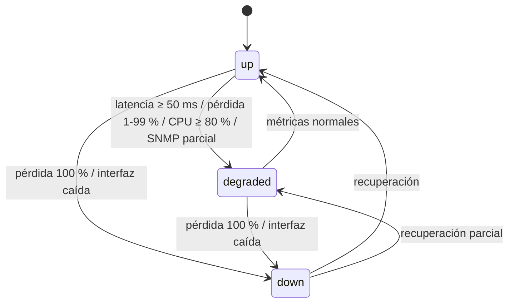

# Modelo de Datos: NOC Topology & Real-Time Telemetry Dashboard

Todos los modelos viven en memoria (sin persistencia). Se implementan como `dataclass(frozen=True)` o `TypedDict` tipados.

## Enumeraciones
- `NodeType`: `router | switch | server`
- `Status`: `up | degraded | down` (minúsculas en todo el sistema)
- `EventKind`: `down | degraded | recovered`

## Topología (estática, `topology_config.py`)

### Node
| Campo | Tipo | Notas |
|---|---|---|
| `id` | `str` | único; `R1-Core`, `R2-Dist`, `R3-Edge` |
| `name` | `str` | etiqueta visible |
| `ip` | `str` | IPv4 válida |
| `type` | `NodeType` | |
| `role` | `str` | `core`, `distribution`, `edge` |
| `position` | `tuple[int, int]` | posición preestablecida en el grafo |
| `snmp_cpu_index` | `int` | índice de `cpmCPUTotal5secRev` (por defecto `1`) |

### Edge
| Campo | Tipo | Notas |
|---|---|---|
| `id` | `str` | único; `link-r1-r2`, `link-r1-r3` |
| `source` / `target` | `str` | `Node.id` existentes |
| `source_if` / `target_if` | `Interface` | nombre + `if_index` |

### Interface
`name: str`, `if_index: int` (ifIndex SNMP). Valores iniciales: `link-r1-r2` → origen `GigabitEthernet0/1`, `link-r1-r3` → origen `GigabitEthernet0/2`; `ifIndex` configurables en `topology_config.py` (en IOSv `Gi0/1` suele ser 2 y `Gi0/2` 3; se verifica en el laboratorio).

**Reglas de validación** (al cargar): ids únicos, `source`/`target` referencian nodos existentes, IPs válidas, sin enlaces duplicados ni auto-enlaces.

## Telemetría (dinámica)

### NodeTelemetry
| Campo | Tipo | Regla |
|---|---|---|
| `id` | `str` | `Node.id` |
| `status` | `Status` | según [research.md R4](research.md) |
| `latency_ms` | `float \| None` | `None` si pérdida 100 % |
| `packet_loss` | `float` | 0–100 (%) |
| `cpu_percent` | `float \| None` | 0–100; `None` si no hay SNMP/CPU |
| `bw_in_kbps` / `bw_out_kbps` | `float` | ≥ 0; suma de las interfaces monitoreadas del nodo |

### EdgeTelemetry
| Campo | Tipo | Regla |
|---|---|---|
| `id` | `str` | `Edge.id` |
| `status` | `Status` | según R4 |
| `oper_status` | `int \| None` | valor SNMP `ifOperStatus` (1 = up) |
| `bw_in_kbps` / `bw_out_kbps` | `float` | ≥ 0 |

### TelemetrySnapshot
`timestamp: str` (ISO 8601 UTC), `simulation: bool`, `nodes: list[NodeTelemetry]`, `edges: list[EdgeTelemetry]`, `events: list[AlertEvent]` (eventos generados en este ciclo).

### AlertEvent
`id: int` (incremental), `timestamp: str`, `element_type: "node" | "edge"`, `element_id: str`, `kind: EventKind`, `previous: Status`, `current: Status`, `message: str`.
Almacenado en `deque(maxlen=100)`; se genera un evento por cada **transición** de estado entre ciclos consecutivos.

## Estado interno de los pollers

### CounterSample (poller real y simulado)
`in_octets: int`, `out_octets: int`, `ts: float` (`time.monotonic()`), por `(node_id, if_index)`. La tasa se calcula con `calculate_kbps(prev, curr, delta_s)` y la primera muestra produce `0.0`.

### SimulationState (solo simulación)
`nodes_down: set[str]`, `edges_down: set[str]`.
Estado efectivo del enlace: `down` si `id ∈ edges_down` **o** `source ∈ nodes_down` **o** `target ∈ nodes_down`.

## Transiciones de estado

